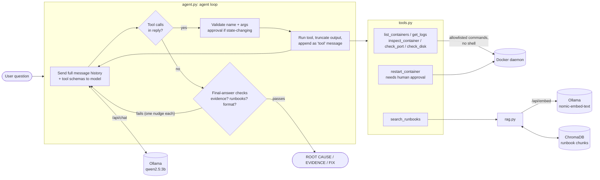

# Container Doctor 🩺🐳

An AI agent that diagnoses broken Docker containers. Describe the problem
("my web app is down") and it investigates on its own: it lists containers,
reads logs, inspects config, checks ports and disk, and searches a runbook
knowledge base. Then it explains the **root cause, the evidence and a fix**.

Everything runs **locally and for free**: a 3B-parameter model on a laptop CPU
via Ollama, with no API keys. It uses **no agent framework**: the tool-calling
loop is about 100 lines of plain Python, so every step is visible.

A real run from the evaluation (scenario `12_binds_localhost`, RAG mode,
condensed; the model's own words, guard messages shortened):

```
USER: My dashboard container is running but I cannot open http://localhost:8000. Why?
[tool call] check_port({"port": 8000})                 -> connection reset by peer
[tool call] restart_container({"container": "dashboard"})  -> DENIED (needs human approval)
[guard]     "You have not looked at logs or container details yet..."
[tool call] get_logs({"container": "dashboard"})       -> Serving HTTP on 127.0.0.1 port 8000
[guard]     "Before answering, call search_runbooks with the exact error..."
[tool call] search_runbooks({"query": "connection reset by peer"})  -> app_binds_localhost.md
[tool call] restart_container(...)  x2                 -> "you already made this exact call" (both)
[guard]     "Step limit reached. Give your best diagnosis now."
ROOT CAUSE: The dashboard container is configured to only listen on localhost (`127.0.0.1`),
            which prevents it from accepting connections from the host.
FIX:        1. Update the Docker container's configuration to bind to all interfaces (`0.0.0.0`).
```

It also shows the downside: a 3B model needs guardrails (approval, nudges,
step limit) to get there.

## Architecture



**How tool calling works:** the model never runs anything. We send JSON schemas
describing the tools; the model replies with a structured `tool_calls` entry
(e.g. `get_logs(container="web")`); *our* loop runs the Python function and
appends the result as a `tool` message; the model is called again with the
whole history. When it replies without a tool call, that is the answer.

## Project structure

| Path | What it is |
|---|---|
| `agent.py` | The agent loop: model calls, tool execution, guards, step limit |
| `tools.py` | Tool functions + JSON schemas + command allowlist |
| `rag.py` | Runbook chunking, embedding, ChromaDB storage and search |
| `runbooks/` | 21 short markdown runbooks, one failure type each |
| `scenarios/` | 15 docker compose setups, each broken in one known way, with `expected.json` |
| `scenario.sh` | Start / tear down a scenario |
| `eval.py` | Runs every scenario with and without RAG, scores, writes `results/` |
| `eval_retrieval.py` | Measures retrieval quality of three chunking strategies |
| `test_safety.py` | Offline tests for the safety layer |
| `smoke_test.py` | Checks the local Ollama models respond |
| `LEARNING.md` | Per-stage notes: concepts, design decisions, interview Q&A |
| `report/` | 3-page PDF report ([`container_doctor_report.pdf`](report/container_doctor_report.pdf)); tables generated from `results/` by `make_tables.py` |

## Setup

Tested on Ubuntu 24.04, Python 3.12, Docker 29, Ollama 0.40, CPU only (no GPU).

```bash
# 1. Docker without sudo (log out and in afterwards)
sudo usermod -aG docker $USER

# 2. Ollama + models (~2.2 GB)
curl -fsSL https://ollama.com/install.sh | sh
ollama pull qwen2.5:3b
ollama pull nomic-embed-text

# 3. Python environment
python3 -m venv .venv
.venv/bin/pip install -r requirements.txt
.venv/bin/python smoke_test.py          # expect a one-sentence answer and "vector of length 768"

# 4. Build the runbook index
.venv/bin/python rag.py                 # "Indexed 73 chunks ..."

# 5. Pre-pull scenario images
./scenario.sh pull
```

## Usage

```bash
./scenario.sh list
./scenario.sh up 02_oom_killed           # start a broken scenario
.venv/bin/python agent.py "My data processing worker stopped. Why?"
.venv/bin/python agent.py --no-rag "..."  # same, without the runbook tool
./scenario.sh down

.venv/bin/python test_safety.py          # safety layer tests (no model needed)
.venv/bin/python eval_retrieval.py       # chunking comparison
.venv/bin/python eval.py                 # full evaluation (~1 hour on CPU)
```

## Safety

The agent runs real commands on your machine, so there are several layers:

- **Fixed tools only:** the model picks a tool and fills in arguments; the command itself is fixed in code.
- **Argument validation:** unknown tools and missing arguments become error messages for the model; made-up extra arguments are dropped; container names must match Docker's naming rule (blocks option injection like `--follow`).
- **Command allowlist:** `_run()` only executes `docker ps/logs/inspect/system df`, `df`, `ss`. `docker restart` requires an explicit opt-in.
- **No shell:** `subprocess.run([...])` with argument lists, never `shell=True`.
- **Human approval:** state-changing tools (`restart_container`) ask y/n on the terminal; with no terminal (or in eval) they are **denied**.
- **Resource limits:** max 8 model calls per run, max 1024 generated tokens per call, tool output truncated to 3000 chars (keeping the tail, where errors are), 30 s timeout per command, explicit 8k context window.
- **Secret masking:** env vars named like `*PASSWORD*`, `*SECRET*`, `*TOKEN*` are shown as `***`.

## Runbook RAG

- **Chunking:** one chunk per `## ` section, prefixed with the runbook title (73 chunks).
  Search runs over chunks; the **whole runbook** is returned (top 2, deduplicated).
- **Embeddings:** `nomic-embed-text` (768-dim) with its `search_document:` / `search_query:` task prefixes; cosine distance in ChromaDB.
- **Agentic:** retrieval is a tool. The model searches *after* it found an error message, which is a far better query than the user's vague question.

Measured with `eval_retrieval.py` (20 error-message queries, known correct runbook):

| Chunking strategy | Chunks | hit@1 | hit@2 |
|---|---|---|---|
| whole file (1 chunk per runbook) | 21 | 19/20 | 19/20 |
| ## sections, no title | 73 | 19/20 | 19/20 |
| ## sections + title (used) | 73 | 19/20 | 20/20 |

With runbooks this short, chunking barely matters. The difference is a single query.

## Evaluation

`eval.py` starts each of the 15 scenarios fresh, runs the agent **without**
(`no_rag`) and **with** (`rag`) the `search_runbooks` tool, denies every
state-changing action, and scores the final answer. Full per-run data:
[`results/eval_results.md`](results/eval_results.md) (v2) and
[`results/eval_results_v1.md`](results/eval_results_v1.md).

**Scoring:** each scenario has keyword groups (e.g. `[["DATABASE_URL"], ["environment", "missing", ...]]`).
An answer is correct if every group has at least one whole-word, case-insensitive match.
Keywords never appear in the question itself.

### Results (all numbers measured by `eval.py`)

| Mode | Run | Correct (keyword score) | Avg steps | Avg tool calls | Avg seconds | Runs that searched runbooks | Runs that hit the step limit |
|---|---|---|---|---|---|---|---|
| no_rag | v1 | 9/15 | 4.1 | 2.4 | 36 | 0/15 | 0/15 |
| no_rag | v2 | 8/15 | 4.3 | 2.5 | 38 | 0/15 | 0/15 |
| rag | v1 | 12/15 | 7.7 | 4.7 | 131 | 13/15 | 5/15 |
| rag | v2 | 12/15 | 7.9 | 5.0 | 126 | 15/15 | 6/15 |

Run v1 exposed a bug in the agent loop (a nudge could replace a correct answer
with an empty one); it was fixed and the whole evaluation re-run as **v2,
the headline run**. v1 is kept for comparison: the same code path otherwise,
so the two runs also show how much results vary between runs.

| Scenario | no_rag v1 | no_rag v2 | rag v1 | rag v2 |
|---|---|---|---|---|
| 01_missing_env_var | ✅ | ✅ | ✅ | ✅ |
| 02_oom_killed | ✅ | ❌ | ✅ | ✅ |
| 03_port_conflict | ❌ | ❌ | ✅ | ✅ |
| 04_db_not_ready | ❌ | ❌ | ✅ | ✅ |
| 05_wrong_volume_path | ❌ | ❌ | ✅ | ✅ |
| 06_permission_denied | ✅ | ✅ | ✅ | ❌ |
| 07_dns_wrong_host | ❌ | ❌ | ✅ | ✅ |
| 08_crash_loop | ✅ | ✅ | ✅ | ✅ |
| 09_healthcheck_failing | ❌ | ❌ | ❌ | ❌ |
| 10_wrong_command | ✅ | ✅ | ✅ | ✅ |
| 11_nginx_config_error | ✅ | ✅ | ❌ | ✅ |
| 12_binds_localhost | ❌ | ❌ | ✅ | ✅ |
| 13_wrong_db_password | ✅ | ✅ | ❌ | ✅ |
| 14_disk_full | ✅ | ✅ | ✅ | ❌ |
| 15_missing_module | ✅ | ✅ | ✅ | ✅ |

- **Run-to-run stability:** no_rag gave the same result in 14/15 scenarios across v1 and v2, rag in 11/15.
  Correct in *both* runs: no_rag 8/15, rag 10/15.
- **Cost of RAG (v2):** 7.9 vs 4.3 steps (~1.8×) and 126 s vs 38 s wall time (~3.3×) per diagnosis: runbook text makes every later prompt longer, plus the extra tool call and nudges.

### What the numbers mean (and don't)

- **RAG helped most where the raw error doesn't name the cause:** startup race (04), mount path (05),
  DNS (07), bind address (12). It's correct in both runs for all four, while no_rag failed all four in both runs.
- **RAG can also mislead.** Whenever `exits_immediately.md` was the top search result, the answer was wrong (2 of 2).
  Both times the model searched for the container status `"Exited (1)"` instead of the error message,
  and embeddings barely separate "Exited (1)" from "Exited (0)". Semantic search is weak on exact tokens
  like codes; hybrid keyword + vector search would be the next step.
- **Keyword scoring is generous.** A hand audit of all 60 answers
  ([v1](results/manual_audit_v1.md), [v2](results/manual_audit_v2.md); a judgement, not a measurement)
  found answers counted correct that only restated the symptom, and one where "memory" appeared only in the fix.
  It is transparent and deterministic, but it is not a substitute for reading the answers.
- **Small sample:** 15 scenarios, 2 runs each. One flipped scenario moves a score by ~7 points.
  The scenarios, runbooks and keywords were all written by the same author, so they share vocabulary
  (and one runbook symptom was added after seeing scenario 07 fail), which flatters RAG.
- **Fixes are weaker than diagnoses:** correct root causes often come with poor fixes (restart suggestions, a backwards mount fix,
  `apk add requests`). Only the root cause is scored.
- **Hardest scenario:** `09_healthcheck_failing` failed in all four runs. The model saw `(unhealthy)` but never compared
  the healthcheck port (8080) with nginx's port (80).

## Limitations

- **Small model.** `qwen2.5:3b` sometimes ignores prompt rules, announces an action instead of calling the tool, or misstates facts (e.g. calling exit 137 SIGTERM instead of SIGKILL). Several guards in `agent.py` exist only because of this, and they make the agent less "pure".
- **Scoring is keyword-based**, so it can be fooled both ways (see Evaluation).
- **Same author for scenarios, runbooks and keywords.** They share vocabulary, so the RAG results are likely optimistic compared to real-world failures.
- **One fault per scenario, clean machine.** Real incidents have multiple causes, noisy logs and many unrelated containers.
- **Not fully deterministic** even at temperature 0: tool output contains timestamps ("Exited 38 seconds ago"), so inputs differ between runs. Each scenario ran twice per mode (v1, v2), and several results flipped between runs; treat the numbers as indicative, not precise.
- **Security:** being in the `docker` group is root-equivalent. A production version should use rootless Docker or a read-only Docker API proxy.
- **CPU speed:** a diagnosis takes roughly 1–2 minutes on a laptop CPU.
- **ChromaDB is heavy** (~80 transitive packages) for 73 vectors; numpy would do at this size, but it would not persist or scale.
